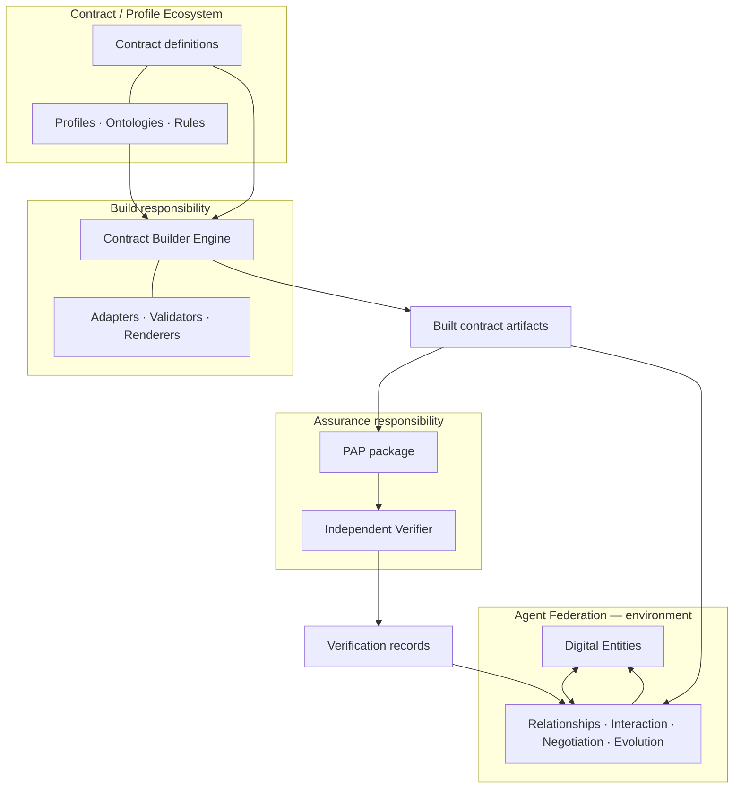
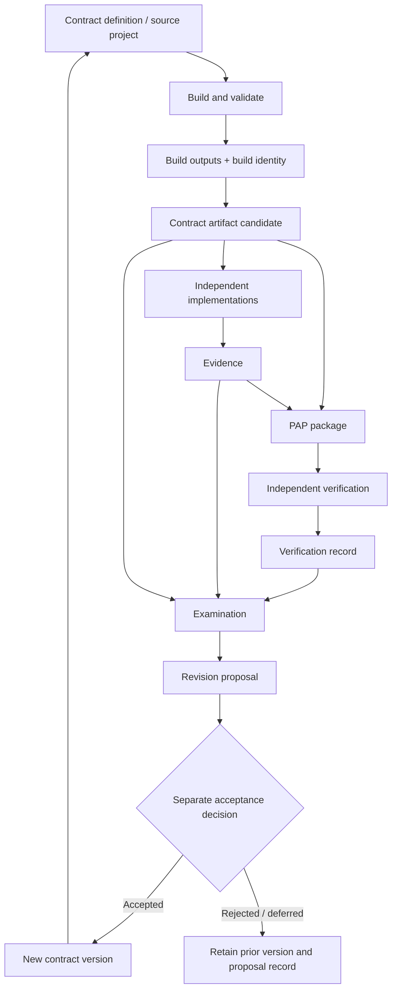

# AGENT-FEDERATION-ARCHITECTURE-001 — System Boundaries & Artifact Lifecycle

**Document version:** 0.1  
**Status:** DRAFT  
**Date:** 2026-11-02  
**Type:** System architecture synthesis  
**Normative authority:** None  
**Related tracking:** [#70](https://github.com/agent-federation/contract-builder/issues/70), [#40](https://github.com/agent-federation/contract-builder/issues/40), [#68](https://github.com/agent-federation/contract-builder/issues/68)

> This document is a reviewable architecture map, not an accepted architecture baseline. It describes established project evidence, proposes boundaries for discussion, preserves exploratory ideas as exploratory, and records unresolved questions without silently deciding them.

---

## 1. Purpose

Agent Federation is being explored as an environment in which independent digital entities can exist, establish relationships, exchange contracts, interact within explicit boundaries, and evolve.

The project already contains work on contract construction, profile-driven specification models, provenance, assurance packages, and independent verification. These efforts need a shared system-level map so that local implementation decisions do not accidentally collapse distinct responsibilities or identities.

This document provides that map. It answers:

- What are the major responsibilities in the ecosystem?
- Which artifacts are created, consumed, and verified at each stage?
- Which identities must remain distinct?
- Where must dependencies and authority stop?
- Which parts are established, proposed, exploratory, or still open?

### 1.1 Architectural direction

**PROPOSED**

Use the following as a conceptual organizing axis:

`Build → Assure → Interact → Evolve`

- **Build:** construct and validate explicit contract specifications.
- **Assure:** make evidence and verification results inspectable and portable.
- **Interact:** allow independent entities to use, negotiate, accept, reject, or leave contractual relationships.
- **Evolve:** permit controlled revision while preserving history and separating proposals from accepted changes.

This is a responsibility map, not a mandatory linear runtime pipeline. Not every interaction must invoke every component.

### 1.2 Scope

In scope:

- Contract Builder and its profile/project model.
- PAP and independent verification boundaries.
- Contract and profile ecosystem.
- Implementations, evidence, examination, acceptance, and revision.
- Digital entities and the Agent Federation environment.
- Artifact identities, lifecycle, dependencies, and trust boundaries.

Out of scope:

- Defining the complete ontology of Digital Entities.
- Defining a federation protocol, network transport, or runtime.
- Defining the Contract Artifact Format.
- Expanding PAP v0.1.
- Specifying a universal governance or authority model.
- Claiming that planned packages, services, or interoperability mechanisms already exist.

---

## 2. Status and evidence vocabulary

The following labels apply to substantive statements in this document.

| Label | Meaning |
|---|---|
| **ESTABLISHED** | Supported by an existing accepted decision, specification, or observed implementation. The evidence must be cited. |
| **PROPOSED** | An architecture direction suggested for review; not yet accepted. |
| **EXPLORATORY** | A research hypothesis or conceptual direction; not an architecture commitment. |
| **OPEN** | Unresolved. No decision or behavior should be inferred. |

These labels describe the maturity of a statement, not its truth value or authority.

Implementation evidence has separate dimensions:

- **Decision:** was the direction explicitly accepted?
- **Implementation:** does code currently implement it?
- **Tests:** do automated tests exercise it?
- **Independent verification:** has a distinct reviewer or implementation independently checked it?

A design can be accepted but unimplemented. Code can exist without independent verification. A passing test suite does not by itself establish normative correctness or independent verification.

---

## 3. Conceptual model

### 3.1 Digital Entity

**EXPLORATORY**

A **Digital Entity** is a candidate top-level concept for something that can maintain an identity or continuity claim, possess capabilities and boundaries, establish relationships, and participate in interactions in a digital environment.

The concept is intentionally broader than an autonomous agent. An agent may be one kind of digital entity or one mode through which an entity acts; this relationship is not yet a normative ontology.

Candidate concerns include:

- identity and continuity;
- autonomy and operational boundaries;
- capabilities and resources;
- relationships and commitments;
- evidence and claims;
- governance and authority;
- evolution and version history.

These are research dimensions, not required fields of an established entity schema.

### 3.2 Agent

**OPEN**

The precise relationship between `Agent`, `Digital Entity`, `Runtime Instance`, `Implementation`, `Participant`, and `Authority Principal` remains unresolved.

Do not use these terms interchangeably. In particular:

- an implementation is not automatically an identity;
- a runtime process is not automatically a participant;
- a cryptographic key is not automatically an authority principal;
- identity lineage does not automatically transfer authority.

### 3.3 Contract

**PROPOSED**

A **Contract** is a versioned, interpretable agreement or specification that defines a bounded set of terms, expectations, permissions, obligations, constraints, or interaction semantics between relevant parties.

A contract's content, identity, implementation, evidence, assurance package, and acceptance state are distinct concerns.

This document does not define the canonical contract data model or its identity format.

### 3.4 Profile and project

**ESTABLISHED — Contract Builder**

The current Contract Builder model distinguishes:

- **Engine/core:** generic mechanisms for loading, extraction, identity/reference integrity, provenance plumbing, diagnostics, orchestration, artifact checking.
- **Profile:** domain-specific kinds, relations, schemas, provenance mappings, rules, review policy, labels, templates, and hooks.
- **Project:** concrete specification content plus its manifest.
- **Adapter:** reads an input format and resolves source locators.
- **Renderer:** turns a validated model into output artifacts.

This separation is documented in the [Engine Public Contract](engine-public-contract.md). The current implementation status is recorded separately in [Implementation Status](implementation-status.md).

### 3.5 Evidence, claims, findings, and rulings

**ESTABLISHED — project-wide epistemic direction; application to this architecture is PROPOSED**

Keep the following concepts separate:

- **Claim:** an assertion made by a producer or participant.
- **Evidence:** material offered in support of, or against, a claim.
- **Examination:** a methodical assessment of available evidence within a stated scope.
- **Finding:** what an examination establishes, including its limitations.
- **Ruling:** a separate normative act by an authority entitled to make it.

A verification result is not automatically a finding about the truth of a claim, and a finding is not automatically a ruling. The exact mapping between these concepts and PAP records remains subject to the relevant specifications.

---

## 4. System boundaries and responsibilities

### 4.1 Context map

**PROPOSED**

The following is a logical responsibility map. It is not a deployment diagram and does not assert that every box is already a separate package or service.

The arrows indicate possible artifact or information flows, not trust, authority, endorsement, or mandatory runtime dependencies.

### 4.2 Responsibility map

| Responsibility | Primary concern | Must not silently become |
|---|---|---|
| Contract Builder Engine | Build and validate explicitly declared specification models; produce deterministic build outputs within its guarantees | Normative author, dispute adjudicator, trust authority, or PAP verifier |
| Profile | Supply domain-specific structure, policy, schemas, checks, and rendering behavior | Generic engine semantics or authority over unrelated domains |
| Contract / Profile Ecosystem | Maintain definitions, versions, profiles, and domain vocabularies | A single universal ontology by assumption |
| PAP | Package assurance-relevant materials and expose portable verification inputs/results | A source of truth, a governance authority, or a guarantee that a claim is true |
| Independent Verifier | Evaluate a package against a declared PAP version/tier and report scope and outcomes | A producer, contract author, or authority to approve participation |
| Implementation | Realize some contract or profile behavior | Proof that the contract is correct or that another implementation agrees |
| Agent Federation | Provide the conceptual environment for entity interaction and evolution | A synonym for a message bus, orchestrator, or single agent runtime |

### 4.3 Current implementation facts

**ESTABLISHED — repository snapshot, 2026-11-02**

- Contract Builder M1 has a profile-driven engine implementation and a synthetic example profile. The implementation-status record explicitly distinguishes this evidence from proof of broad genericity.
- The accepted public engine contract describes a wider surface than M1 currently implements. Public API extraction, packaging, and publication are deferred; the repository status record says nothing is independently packaged or published at this snapshot.
- PAP v0.1 has an accepted specification direction and a verifier implementation under review. The open implementation work must not be described as completed or independently verified merely because the specification was accepted.
- Agent Federation as an environment for digital entities remains exploratory in [#68](https://github.com/agent-federation/contract-builder/issues/68).

Sources: [Engine Public Contract](engine-public-contract.md), [Implementation Status](implementation-status.md), [Build Identity](build-identity.md), [PAP specification and implementation tracking](https://github.com/agent-federation/contract-builder/issues/44), [PAP verifier PR](https://github.com/agent-federation/contract-builder/pull/64).

---

## 5. Artifact taxonomy and identity boundaries

### 5.1 Candidate artifact classes

**PROPOSED**

| Artifact | Purpose | Typical producer | Consumer |
|---|---|---|---|
| Contract source project | Human- and machine-maintained inputs defining a contract | Contract/profile author | Contract Builder |
| Profile | Reusable domain schema, policy, checks, and presentation definition | Profile maintainer | Contract Builder |
| Build output | Rendered or machine-readable result of one build | Contract Builder | Humans, tools, downstream packaging |
| Build manifest / identity record | Records the declared inputs and extension closure used for a build | Contract Builder | Auditors, reproducibility tooling |
| Contract artifact | Candidate stable, versioned representation of a contract | Contract ecosystem / authoring workflow | Implementers, entities, verifiers |
| Implementation | A concrete realization of some contract version | Implementer | Tests, counterparties, examiners |
| Evidence bundle | Evidence produced or collected about an implementation or claim | Producer, test harness, observer | Examiner, PAP packaging |
| PAP package | Portable assurance package containing declared materials and relationships | PAP producer/tooling | Independent verifier |
| Verification record | Result of a specific verifier evaluating a specific package under a stated scope | Verifier | Consumers, examiners |
| Examination record | A reasoned assessment of claims and evidence, including limitations | Examiner | Relevant decision process |
| Acceptance / ruling record | A separate normative act by an identified authority, if such authority exists | Authorized actor/process | Participants and later audits |

This table is a conceptual inventory. It does not claim that all listed artifact formats currently exist.

### 5.2 Identity separation

**PROPOSED — required design constraint**

Do not overload one identifier to represent different things.

| Identity | Identifies | Does not identify |
|---|---|---|
| **Contract Identity** | A stable contract lineage or logical contract subject | A particular build, file, package, or acceptance |
| **Contract Version Identity** | A particular immutable revision of contract content | A build execution or verification |
| **Build Identity** | The declared inputs and build-relevant dependency closure for one build | The semantic identity or legitimacy of the contract |
| **Implementation Identity** | A particular implementation/version and its declared provenance | The contract itself or proof of conformance |
| **PAP Package Identity** | A particular assurance package and its content | The contract's identity or the verifier's conclusion |
| **Verification Record Identity** | A particular verifier's evaluation, including version, tier, scope, checks, and witness-relevant data | Truth, trust, authority, or universal agreement |

**ESTABLISHED — current narrow fact:** Contract Builder already has a deterministic build identity concept based on declared inputs and extension closures. It is not the same thing as a future Contract Identity or PAP Package Identity. See [Build Identity](build-identity.md).

**OPEN:** The canonical identity and versioning rules for a Contract Artifact are not defined. The name *Contract Artifact Format* is used here only as a placeholder for that unresolved design area.

### 5.3 Why the distinctions matter

One contract version may have:

- multiple independent implementations;
- multiple builds from different toolchains or profiles;
- multiple evidence bundles;
- multiple PAP packages;
- multiple verification records from different verifiers or tiers;
- multiple examinations and separately authorized acceptance decisions.

A new verification record must not mutate the identity or content of the package it evaluates. A new build must not silently create a new normative contract version. A new implementation must not inherit authority from the contract author or another implementation.

---

## 6. Artifact lifecycle

### 6.1 Lifecycle overview

**PROPOSED**

This is a conceptual lifecycle, not a claim that a complete end-to-end workflow exists today.

### 6.2 Lifecycle semantics

1. **Define.** A project author declares contract content and selects or authors a profile.
2. **Build.** Contract Builder loads declared inputs, validates structural and profile constraints, and emits build outputs and diagnostics.
3. **Identify.** The build records the identity of its declared inputs and build-relevant dependencies. This is not a contract-version decision.
4. **Publish or exchange.** A contract artifact candidate is made available to other entities. Its canonical format and publication protocol remain open.
5. **Implement.** One or more parties create independent implementations against a stated contract version.
6. **Collect evidence.** Tests, observations, traces, source references, and other materials are collected with explicit provenance and scope.
7. **Package assurance materials.** PAP packages declared materials and relationships for portable inspection and verification.
8. **Verify.** An independent verifier evaluates the package within a declared version, tier, and check scope, producing a verification record.
9. **Examine.** Relevant parties or processes assess claims, evidence, limitations, conflicts, and verification records.
10. **Propose revision.** Experience or evidence may motivate a proposed change. A proposal is not itself a change to the normative contract.
11. **Decide separately.** Acceptance, rejection, deferral, or another ruling requires a distinct act by the relevant authority or process. The authority model is not defined here.
12. **Version and preserve history.** An accepted revision creates a new contract version; prior versions and their evidence remain addressable.

### 6.3 Non-automatic transitions

The following transitions must never be inferred merely from a previous stage:

- Build success does not imply normative correctness.
- PAP package creation does not imply verification.
- Verification PASS does not imply truth, safety, legitimacy, consent, or acceptance.
- Evidence does not automatically establish a finding.
- A finding does not automatically create a ruling.
- A revision proposal does not modify the active contract.
- Identity continuity or lineage does not transfer authority.
- A signature proves only what the relevant signature scheme and key-binding establish; it does not create authority by itself.

---

## 7. Dependency and trust boundaries

### 7.1 Dependency direction

**PROPOSED**

- Contract Builder may consume contract project inputs and profiles.
- A PAP producer may consume build outputs, implementation evidence, and other declared materials.
- A PAP verifier must be able to inspect and verify a package without importing or executing the producer's Contract Builder implementation or trusting the producer's profile runtime.
- Contract Builder must not depend on a specific PAP verifier implementation.
- A contract consumer must be able to inspect the contract artifact without requiring the original build environment to remain available.
- Agent Federation should not require a single Contract Builder, PAP implementation, model provider, runtime, repository host, or identity provider.

These are architectural independence goals. The current repository does not yet demonstrate every boundary through separately published packages or cross-implementation tests.

### 7.2 Trust is not transitive by default

The architecture must not silently transfer trust across component boundaries.

Examples:

- Trust in a build tool does not imply trust in the contract's author.
- Integrity of a PAP package does not imply truth of its claims.
- A valid signature does not imply the signer has authority over the subject.
- A verifier's PASS is scoped to that verifier, version, tier, and checks.
- A profile's successful execution does not make its policy universally legitimate.
- A federation participant's identity continuity does not imply continuity of permissions.

### 7.3 Epistemic and normative separation

**PROPOSED**

Preserve a chain of distinct acts:

`Witnessing / Evidence → Examination → Finding → Ruling`

The architecture may support these acts with records and references, but it must not collapse them into one status field or one automated transition.

---

## 8. Open architecture questions

The following questions are intentionally unresolved.

| ID | Question | Why it matters | Current status |
|---|---|---|---|
| OA-01 | What exactly is a Digital Entity, and is Agent a subtype, role, or execution mode? | Establishes the environment's conceptual vocabulary | EXPLORATORY |
| OA-02 | What is the canonical Contract Artifact Format and its identity/versioning model? | Needed for stable exchange, forking, and revision | OPEN |
| OA-03 | How does a contract version relate to a source project, profile version, and build output? | Prevents build identity from becoming semantic identity | OPEN |
| OA-04 | What is the minimum portable PAP package boundary, and which materials are required? | Defines what a verifier can inspect independently | Governed by PAP v0.1 scope; future extensions OPEN |
| OA-05 | How are verifier identities, methods, versions, tiers, and scopes represented across implementations? | Needed for meaningful comparison without overstating agreement | OPEN beyond current PAP specification |
| OA-06 | What is a participant, and how does it relate to entity, runtime, implementation, and authority principal? | Prevents identity and authority conflation | OPEN |
| OA-07 | How are consent, acceptance, delegation, revocation, and exit represented? | Needed for real federation relationships | OPEN |
| OA-08 | What is the authority model for making a ruling or accepting a contract revision? | Prevents verification or lineage from becoming authority by accident | OPEN |
| OA-09 | How are conflicts between findings or verifier results represented and examined? | Avoids reducing disagreement to a single global status | OPEN |
| OA-10 | Which artifact formats require canonical serialization, content addressing, signatures, or transparency logs? | Avoids premature cryptographic commitments | OPEN |
| OA-11 | Which responsibilities should become separately distributed packages, and when? | Avoids premature package fragmentation | OPEN |
| OA-12 | What transport and discovery mechanisms support entity interaction? | Needed for deployment/interoperability, but not for this conceptual architecture | OPEN |

---

## 9. Evolution path

**PROPOSED — sequencing, not a commitment to dates**

1. **Complete current PAP v0.1 implementation review.** Keep the accepted specification and implementation status distinct; do not add new PAP scope through this architecture document.
2. **Clarify the Contract Builder public boundary.** Continue from the existing public contract and M1 evidence. Package extraction/publication remains a separate decision and implementation step.
3. **Exercise self-description.** Use a real contract/profile project to test whether Contract Builder can describe and validate its own declared contract without assuming that self-consistency equals correctness.
4. **Research Contract Artifact Format.** Resolve identity, versioning, canonical representation, and relation to build outputs before standardizing exchange.
5. **Prototype two independent entities.** Use two independently implemented participants, one shared contract version, separate evidence, and independent verification. Exercise propose, accept, reject, revise, and leave as separate recorded acts.
6. **Evaluate interoperability.** Compare independent implementations and verifiers at explicitly comparable tiers and scopes. Record disagreement and incomplete coverage rather than forcing a global PASS.

This sequence deliberately separates current implementation work from broader Agent Federation research.

---

## 10. Architecture decision register

This register records the maturity of the directions in this draft. It is not a normative decision log.

| ID | Statement | Status | Decision needed |
|---|---|---|---|
| ADR-AF-001 | Use Build → Assure → Interact → Evolve as a conceptual organizing axis | PROPOSED | Maintainer review |
| ADR-AF-002 | Treat Agent Federation as an environment for digital entities, broader than an agent orchestration runtime | EXPLORATORY | Research and terminology work |
| ADR-AF-003 | Keep Contract Builder and PAP as distinct responsibilities with an independent verification boundary | PROPOSED, aligned with current design direction | Review against PAP implementation and future interoperability |
| ADR-AF-004 | Keep contract, version, build, implementation, package, and verification-record identities distinct | PROPOSED | Define through Contract Artifact Format research |
| ADR-AF-005 | Do not infer authority from identity lineage, signature, reputation, or verification outcome | PROPOSED architectural invariant; consistent with existing UIA research direction | Cross-document review before normative adoption |
| ADR-AF-006 | Keep evidence, examination, finding, and ruling as distinct stages | PROPOSED for this architecture | Map to concrete records and authority model |
| ADR-AF-007 | Do not split every responsibility into a separately published package prematurely | PROPOSED | Revisit when public APIs and independent consumers require it |

No entry in this register is accepted solely by appearing in this document.

---

## 11. Traceability

| Source | Relationship to this document |
|---|---|
| [Issue #40](https://github.com/agent-federation/contract-builder/issues/40) | Existing direction: infrastructure for verifiable agent contracts |
| [Issue #68](https://github.com/agent-federation/contract-builder/issues/68) | Exploratory research: Agent Federation as an environment for digital entities |
| [Engine Public Contract](engine-public-contract.md) | Existing Contract Builder responsibilities and public design surface |
| [M1 Implementation Plan](m1-implementation-plan.md) | Approved first implementation stage and deferred milestones |
| [Implementation Status](implementation-status.md) | Source-backed snapshot separating decisions, implementation, tests, and independent verification |
| [Build Identity](build-identity.md) | Existing build identity design and implementation |
| [PAP RFC / tracking](https://github.com/agent-federation/contract-builder/issues/44) | PAP v0.1 specification work |
| [PAP verifier PR](https://github.com/agent-federation/contract-builder/pull/64) | Initial verifier implementation under review; not evidence of independent interoperability |
| [PAP RFC update PR](https://github.com/agent-federation/contract-builder/pull/66) | Accepted v0.1 status reflected in the RFC |
| [Future Research #68](https://github.com/agent-federation/contract-builder/issues/68) | Digital entity/environment research; remains exploratory |

---

## 12. Review checklist

Before this document can become an accepted architecture baseline, review should confirm:

- [ ] No proposed component boundary is described as an already published package or deployed service.
- [ ] Current implementation claims match the repository's source-backed status records.
- [ ] PAP v0.1 scope and current PR review state are represented accurately.
- [ ] No automatic transition from evidence or verification to acceptance/ruling is implied.
- [ ] Identity categories are distinct and their unresolved formats are explicitly marked.
- [ ] The Digital Entity model remains exploratory until separately examined and accepted.
- [ ] Open questions are not silently resolved by diagrams or terminology.
- [ ] Related RFCs and issues remain independently authoritative for their own scope.

---

## 13. Change history

| Version | Date | Status | Notes |
|---|---|---|---|
| 0.1 | 2026-11-02 | DRAFT | Initial system boundary, artifact taxonomy, lifecycle, and open-question map. |
